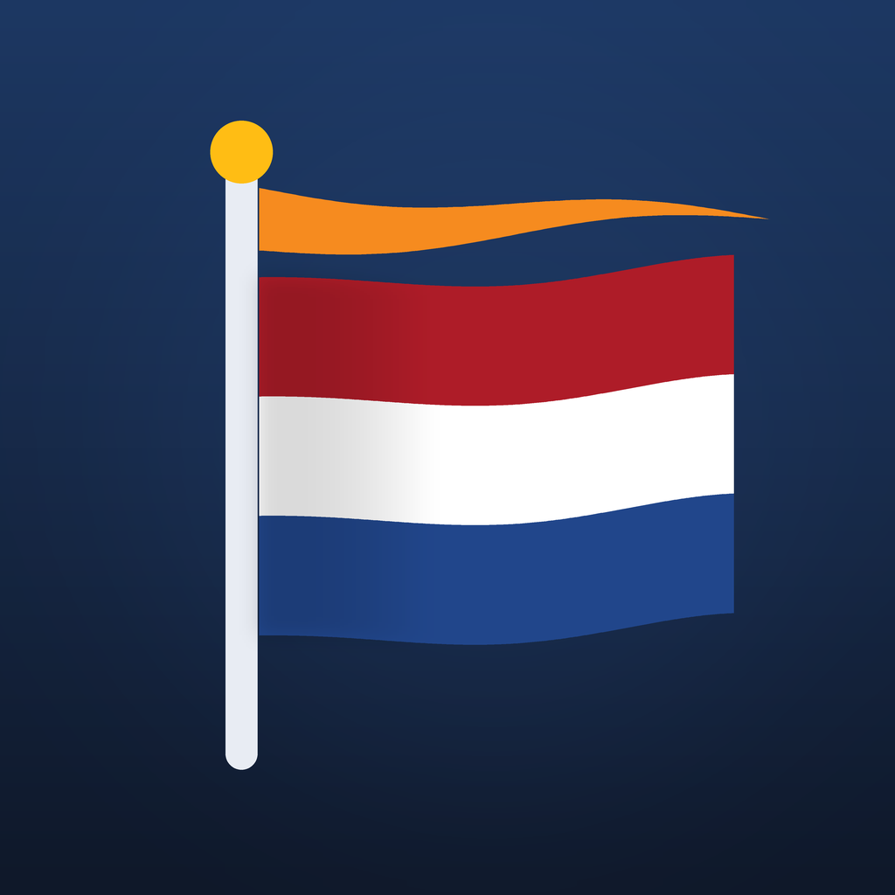

<p align="center">
  
</p>

# Vlagdagen 2.0

**Mag de vlag vandaag uit?** De iPhone-app van [vlagdagen.nl](https://vlagdagen.nl), volledig opnieuw gebouwd in SwiftUI.

| | |
|---|---|
| Bundle ID | `app.lrvdlinden.vlagdagen` |
| Widget | `app.lrvdlinden.vlagdagen.widget` |
| Versie | 2.0.0 (build 2) |
| Minimaal | iOS 17 · iPhone en iPad |

## Functies

- **Geanimeerd openingsscherm**: de vlag wordt gehesen, wappert en krijgt de wimpel
- **Vandaag**: groot *Ja.* of *Nee.*, met de juiste instructie (in top, met wimpel, of halfstok tot zonsondergang)
- **Aftelklok** tot de volgende vlagdag
- **Ochtendmelding**: automatisch op elke vlagdag, op een zelfgekozen tijd (standaard 08:00). Optioneel ook de avond ervoor, en op 4 mei een herinnering om 17:45 om de vlag halfstok te hijsen. Per vlagdag aan of uit te zetten.
- **Agenda-abonnement** voor Apple Agenda (`webcal://`), Google Agenda en Outlook
- **Agenda** met alle vlagdagen voor dit jaar en de twee jaren daarna, inclusief verschoven datums
- **Vlagadvies** op basis van het actuele weer (wind, windstoten, regen, onweer) via Open-Meteo
- **Handleiding** (hijsen, halfstok, wimpel) en **FAQ**
- **Widgets** voor het beginscherm (klein en middel) en het toegangsscherm
- Lichte en donkere modus, Nederlandstalig, verzamelt geen persoonsgegevens

## Hoe de vlagdagen worden berekend

De app gebruikt geen vaste lijst. Hij berekent de vlagdagen zelf volgens de [algemene vlaginstructie van de Rijksoverheid](https://www.rijksoverheid.nl/onderwerpen/grondwet-en-statuut/vraag-en-antwoord/wanneer-kan-ik-de-vlag-uithangen-en-wat-is-de-vlaginstructie). Daardoor werkt hij voor elk jaar.

- Valt een datum op een zondag of een algemeen erkende christelijke feestdag (Pasen, Hemelvaart, Pinksteren of Kerst), dan schuift hij door naar de eerstvolgende dag.
- 4 en 5 mei schuiven nooit.
- Koningsdag gaat bij een zondag naar zaterdag 26 april.
- Veteranendag valt op de laatste zaterdag van juni, Prinsjesdag op de derde dinsdag van september.
- Wimpel op Koningsdag en op de verjaardagen van Máxima, Beatrix en Amalia.

Zie `Shared/FlagDays.swift` en de tests in `VlagdagenTests/`.

## Meldingen: hoe werkt het "automatisch"?

De meldingen zijn **lokale meldingen**. De app plant ze ruim twee jaar vooruit in, en iOS bezorgt ze op het ingestelde tijdstip, ook als de app dicht is. Er is geen server, APNs-certificaat of push-dienst nodig. Elke keer dat de app opent of je een instelling wijzigt, wordt het schema opnieuw opgebouwd. Het blijft onder de limiet van 64 meldingen die iOS hanteert.

Een *speciale* vlaginstructie (bijvoorbeeld bij een ramp of een gebeurtenis in het Koninklijk Huis) is niet vooraf te plannen. Daarvoor is echte push nodig, zie [Volgende stappen](#volgende-stappen).

## Bouwen

```bash
brew install xcodegen
xcodegen            # maakt Vlagdagen.xcodeproj aan
open Vlagdagen.xcodeproj
```

Kies in Xcode bij *Signing & Capabilities* je team, of vul `DEVELOPMENT_TEAM` in `project.yml` in. Daarna: ▶︎ Run.

Bij elke push naar `main` bouwt en test GitHub Actions de app (`.github/workflows/ios.yml`).

## Agenda-feed (Base44)

De app abonneert op `webcal://vlagdagen.nl/api/functions/generateFlagDaysICS`.

`Backend/generateFlagDaysICS.ts` is een verbeterde versie van die Base44-functie. Vervang de huidige functie hiermee. Wat er beter aan is:

- Rekent zelf de datums uit, van vorig jaar tot drie jaar vooruit. De huidige feed bevat alleen 2026.
- Juiste datums. Nu staan Veteranendag op 28-06 en Prinsjesdag op 16-09; dat moet 27-06 en 15-09 zijn.
- Geldige iCal-regels: CRLF-regeleinden, `DTEND`, gevouwen lange regels en vaste `UID`'s.
- `REFRESH-INTERVAL` van één dag.

## App Store

- Teksten (NL): `AppStore/metadata-nl.md`, met beschrijving, wat is nieuw, promotietekst en trefwoorden
- Wijzigingen: `CHANGELOG.md`
- Screenshots: `scripts/screenshots.sh` (simulator, demo-modus) en daarna `python3 scripts/compose_appstore.py <fonts>`
  - iPhone 6,3": `AppStore/screenshots/iphone-6.3` (1206 × 2622)
  - iPad 13": `AppStore/screenshots/ipad-13` (2064 × 2752)
  - Promobanners: `AppStore/promo` (5244 × 2950, 3840 × 1646, 3840 × 2560, 1920 × 1280)

## Structuur

```
Shared/            Vlagdagen-logica + thema (gedeeld met de widget)
Vlagdagen/         App: schermen, meldingen, instellingen, weer
VlagdagenWidget/   WidgetKit-widgets
VlagdagenTests/    Unit tests voor datums en meldingen
Backend/           Base44-functie voor de iCal-feed
project.yml        XcodeGen-projectdefinitie
```

## Volgende stappen

- **Push bij een speciale vlaginstructie**: een Base44-entity `SpecialInstruction` plus APNs (of OneSignal), zodat je met één knop alle gebruikers een melding stuurt
- **Locatie** voor vlagadvies en zonsondergang (nu De Bilt)
- **Interactieve widget** en een **Live Activity** op 4 mei, met aftelklok tot zonsondergang
